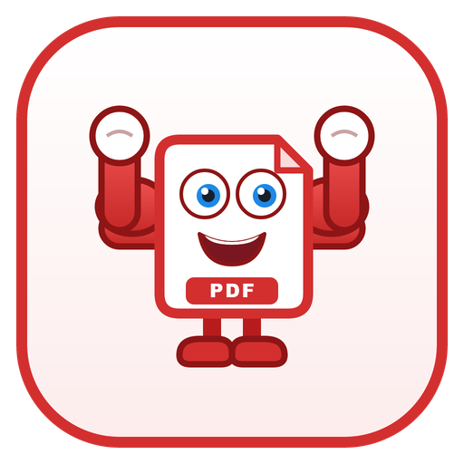
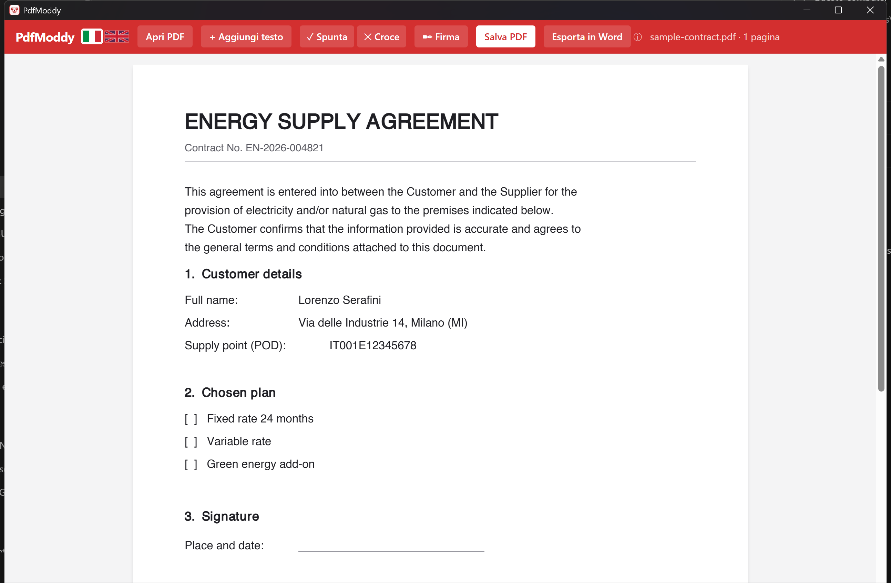
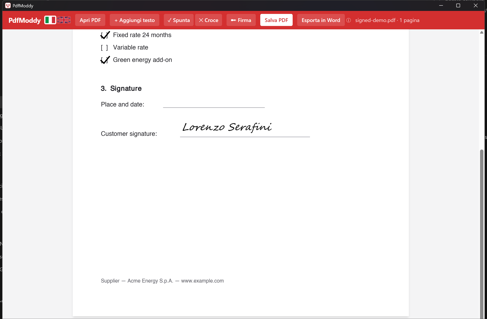

<p align="center">
  
</p>

<h1 align="center">PdfModdy</h1>

**PdfModdy** is a local desktop app for **Windows and macOS** to visually **sign and fill PDF documents** — fully offline, no cloud, no account.

It is **not** a cryptographic/PAdES signer: it places a visual overlay (handwritten‑style signatures, check marks, typed text) on top of the PDF and bakes it into a new file. Think of it as a lightweight, offline alternative for the everyday "print → sign → scan" loop.

> Created by Lorenzo Serafini.

## Screenshots

<p align="center">
  
  <br><em>Open any PDF — sign it, tick check boxes, type text, export to Word.</em>
</p>

<p align="center">
  
  <br><em>A contract filled in and signed in a few clicks, ready to save or export.</em>
</p>

---

## Features

- **Open & render** any PDF (powered by PDF.js).
- **Signatures** — draw one, or type a name rendered in a cursive system font; reusable **signature library** saved locally.
  - Acquire a signature from an existing **PDF, image, or Word/ODT** file, with crop, background removal (color picker + tolerance) and stroke‑strengthening.
- **Check marks** — place a **✓ (V)** or **✗ (X)** on checkboxes, black by default.
- **Text fields** — add block‑letter text anywhere, with font / size / color controls.
- **AcroForm support** — fill the existing form fields of interactive PDFs directly, with an optional "flatten on save" toggle.
- **Save** the result as a flattened PDF.
- **Export to Word (.docx)** — convert the current PDF (with your overlay baked in) using a locally installed **LibreOffice** engine (optional, see below).
- **File association** — open PDFs with PdfModdy and set it as the default PDF app (Windows installer registers the `.pdf` association).
- **Languages** — one‑click **Italian / English** switch with flag buttons; the choice is remembered.
- **Custom app icon**, red/white theme.

Everything runs **100% locally**. The app makes no network requests.

## Word export & LibreOffice (optional)

The PDF → Word conversion uses **LibreOffice** as a local engine. LibreOffice is **not bundled** (it would add hundreds of MB to a ~2 MB installer). PdfModdy detects an existing LibreOffice install; if none is found it shows a banner inviting you to install it (free, from [libreoffice.org](https://www.libreoffice.org)) or to point it at the `soffice` executable manually.

Conversion fidelity is whatever LibreOffice produces: good for most text‑based PDFs, with occasional word/line reflow on complex layouts. It does **not** OCR scanned PDFs.

All other features work without LibreOffice.

## Install

Pre‑built installers are produced from source (see below):

- **Windows** — `PdfModdy_<version>_x64-setup.exe` (NSIS, per‑user, no admin) or `PdfModdy_<version>_x64_en-US.msi`.
- **macOS (Apple Silicon)** — `PdfModdy_<version>_aarch64.dmg`. The app is ad‑hoc signed, so on first launch use **right‑click → Open** (or *System Settings → Privacy & Security → Open Anyway*) to get past Gatekeeper.

## Tech stack

- **[Tauri 2](https://tauri.app)** — desktop shell, native dialogs, installers (MSI/NSIS on Windows, DMG/.app on macOS).
- **[SvelteKit 2](https://kit.svelte.dev) / Svelte 5** (runes), **Vite**, **Tailwind CSS**, **TypeScript** — the UI, built as a static SPA.
- **[PDF.js](https://mozilla.github.io/pdf.js/)** — rendering.
- **[pdf-lib](https://pdf-lib.js.org/)** — overlay baking, AcroForm API, PNG embedding.
- **Rust** — minimal: local file I/O and driving LibreOffice headless. No network, no sidecar.

## Build from source

Prerequisites: **Node.js** (LTS), **Rust** (stable, via [rustup](https://rustup.rs)), and the platform toolchain Tauri needs:

- Windows: **Microsoft C++ Build Tools** and **WebView2** (bundled with Windows 11).
- macOS: **Xcode** or the **Command Line Tools**.

```bash
# from the repository root
npm install
npm install --prefix frontend

# run in development
npm run tauri dev

# build the installer for the current OS
npm run tauri build
```

Build output lands in `src-tauri/target/release/bundle/`.

## Project structure

```
frontend/        SvelteKit app (UI, PDF rendering, overlay, i18n)
  src/lib/pdf/   viewer, coordinate math, annotations store, baking, signatures
  src/lib/i18n/  it.ts (source) + en.ts (type-safe) + runes locale store
src-tauri/       Tauri shell: Rust commands (file I/O, PDF→Word), bundle config
  tauri.conf.json         base config (Windows: MSI + NSIS)
  tauri.macos.conf.json   macOS overrides (app + dmg)
```

## License

Released under the [MIT License](LICENSE). © 2026 Lorenzo Serafini.

---

Created by Lorenzo Serafini.
